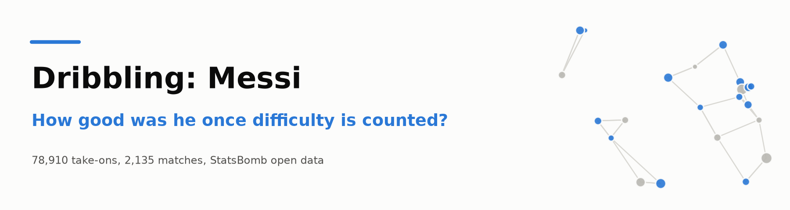
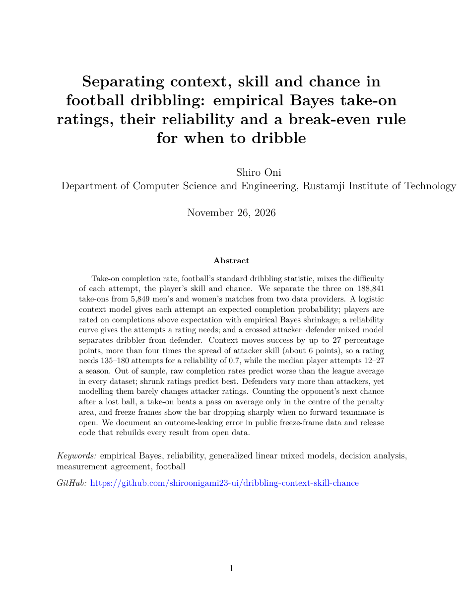
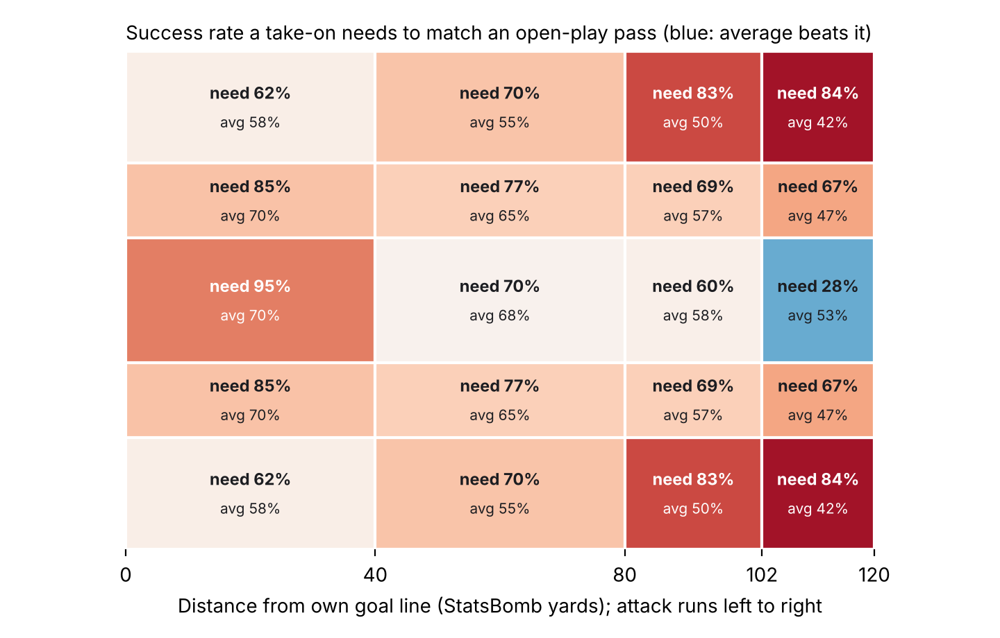
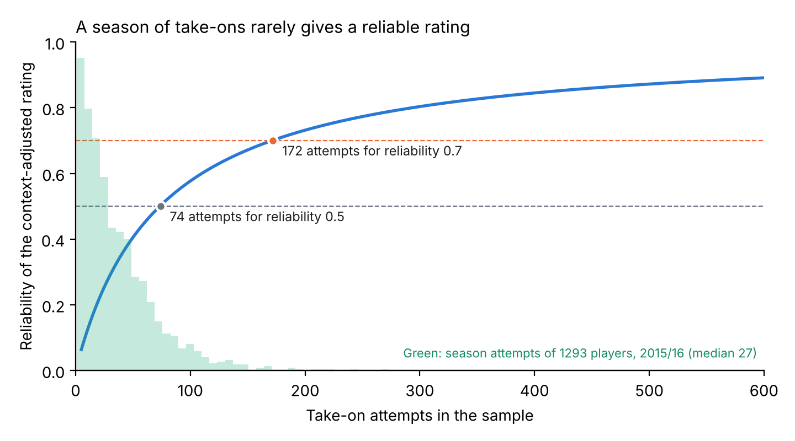
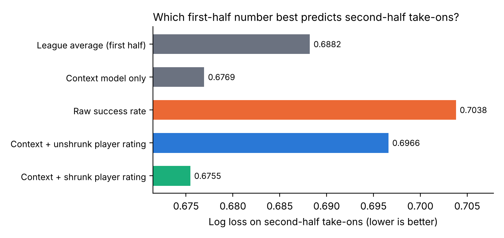
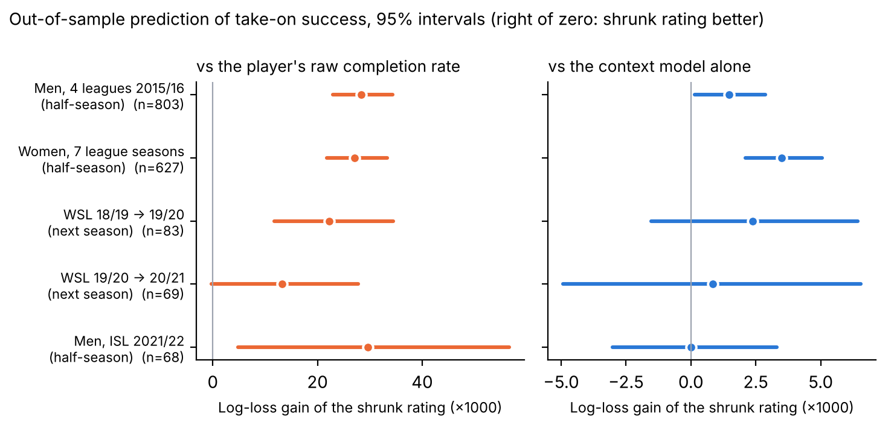
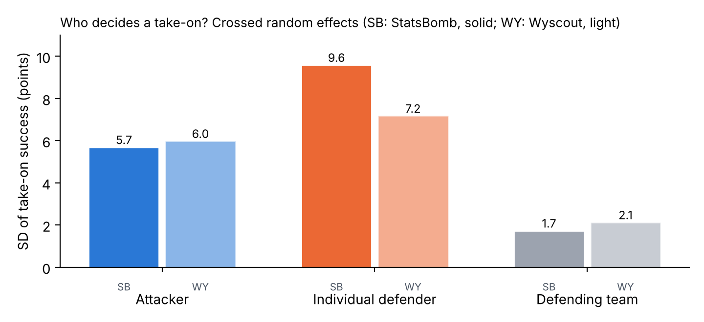
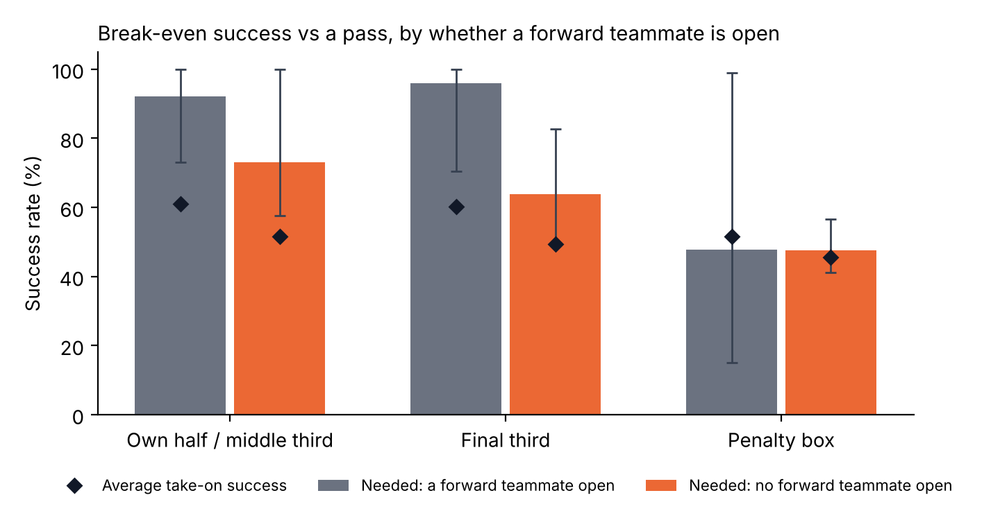

<div align="center">



# Separating context, skill and chance in football dribbling

**Empirical Bayes take-on ratings, their reliability and a break-even rule for when to dribble**

[](https://github.com/shiroonigami23-ui/dribbling-context-skill-chance/actions/workflows/reproducibility.yml)


**Shiro Oni** · [ORCID 0009-0007-2131-9570](https://orcid.org/0009-0007-2131-9570) · Rustamji Institute of Technology, Gwalior

[📄 Manuscript (PDF)](submission/manuscript.pdf) · [📝 DOCX](submission/manuscript.docx) · [🧾 Quarto source](index.qmd) · [📊 Released ratings](results/ratings_2015_16.csv) · [🗺️ Dribble-or-pass table](results/breakeven_third_lane.csv)

</div>

---

## 🧭 What this is

Take-on completion rate is football's standard dribbling statistic, but it mixes three things: how hard each attempt was, the player's skill, and chance. This repository contains a paper, with all of its code and data pipeline, that separates the three on **188,841 take-ons from 5,849 men's and women's matches** from two data providers. It then turns the results into rules a scout or coach can use.

The method has five parts:

1. **Context model.** A logistic GLM gives each take-on an expected success probability, based on pitch zone, score state, phase of play, late game and competition.
2. **Rating.** Players are rated on completions above that expectation, with **empirical Bayes shrinkage**.
3. **Reliability curve.** Says how many attempts a rating needs before it measures the player rather than chance.
4. **Crossed attacker × defender GLMM** (R `lme4`). Separates the dribbler from the defender he faced.
5. **Break-even rule.** Gives the success rate a take-on needs to beat a pass in each area, counting the opponent's chance after a lost ball, with a Bayesian version for individual players.

Every step is tested out of sample. It is replicated on women's football, on 463 men's matches the model never saw, with **StatsBomb 360 freeze frames**, and on a **second provider (Wyscout)**.

<div align="center">
<a href="submission/manuscript.pdf"></a>
</div>

## 🧪 Key findings

| | Result |
|---|---|
| **Context dominates** | Pitch zone alone moves expected success by up to **27 points**: 70% in central areas of a team's own half, 44% on the wings of the box. Counter-attacks add about 9 |
| **Skill is small** | The true spread between players is **≈ 6 points**. A rating needs **135–180 attempts** for a reliability of 0.7; the median player attempts 12–27 a season |
| **Raw rate fails** | Out of sample, a player's raw completion rate predicts his next half-season **worse than the league average**, in every dataset. The shrunk, context-adjusted rating predicts best |
| **Dribble or pass?** | On average a take-on beats a pass **only in the central penalty area** (needs 28%, averages 53%). Top-decile dribblers also gain in the central channel; nobody gains on the wings of the final third |
| **Look up first** | With a forward teammate open, a take-on outside the box needs > 90% success to pay. With none open, 64–73% |
| **Defenders matter more** | Individual defenders vary more (7.2–9.6 pts) than attackers (5.7–6.0), yet attacker ratings barely change (r ≥ 0.99) |
| **Two providers disagree** | On the same World Cup 2018 matches, StatsBomb and Wyscout agree only moderately on a player's attempts (Lin's CCC 0.51) |
| **Data trap** | In the public 360 data, frames of failed take-ons are stored mirrored. Used as released they leak the outcome (spurious AUC 0.80). Fixed in `fetch_more.py` |

<div align="center">

<br/><sub>Success rate a take-on needs to match an open-play pass from the same area, against the average success there.</sub>
</div>

<div align="center">

<br/><sub>How many attempts a rating needs, against how many players actually attempt in a season.</sub>
</div>

<div align="center">

<br/><sub>Which first-half number best predicts second-half take-ons? (lower log loss is better)</sub>
</div>

<div align="center">

<br/><sub>Out-of-sample gain of the shrunk rating in every dataset, including next-season prediction in the WSL.</sub>
</div>

<div align="center">

<br/><sub>Crossed random effects: the defender a dribbler meets matters more than which dribbler it is.</sub>
</div>

<div align="center">

<br/><sub>From 360 freeze frames: the bar a take-on must clear drops when no forward teammate is open.</sub>
</div>

## ▶️ Reproduce everything

```bash
git clone https://github.com/shiroonigami23-ui/dribbling-context-skill-chance
cd dribbling-context-skill-chance/code
pip install -r requirements.txt          # exact versions: requirements-lock.txt
# R with lme4 and jsonlite is needed for Study 6 (Rscript on PATH)
bash run_all.sh                          # ~1 h, downloads ~2 GB of open data
python src/check_reproduction.py         # compares code/results/ with the committed results/
```

`run_all.sh` runs the whole pipeline in order. Each step prints its name and start time:

| Step | Script | What it does |
|---|---|---|
| Data | `fetch.py` | StatsBomb events for Study 1 (men's club football; complete 2015/16 leagues) |
| Study 1 | `analysis.py` | Context model, shrinkage, benchmark, career series |
| | `sensitivity.py` · `robustness.py` | Seven re-specifications; out-of-fold model, match-clustered bootstrap, posterior ranks, split-half reliability |
| | `practice.py` · `decision.py` | Context map, value table, reliability curve; out-of-sample test, break-even rule, released ratings |
| Data | `fetch_more.py` | Women's and new men's competitions; 360 features, **re-orienting the mirrored frames** |
| Studies 2–3 | `replicate.py` | Women's football (incl. WSL next-season test), transfer to unseen competitions |
| Study 4 | `study360.py` | Defender and teammate context from freeze frames |
| Data | `fetch_wyscout.py` | Public Wyscout data (Pappalardo et al., 2019) |
| Study 5 | `wyscout.py` · `study5_wyscout.py` | Harmonise Wyscout (possessions, xG, defender pairing); replication, two-provider agreement, stability |
| Study 6 | `hierarchical.py` | Crossed attacker × defender GLMM (calls R/`lme4`) |
| Decisions | `decision_bayes.py` | Posterior probability that a take-on beats a pass, per player and area |
| Figures | `figures.py` · `fig_replication.py` · `fig_attack_defence.py` | Every figure |

**Verified:** a clean run on 25 Nov 2026 reproduced all **289,371** numbers in `results/` within 1%. A shorter version of this check runs in [GitHub Actions](.github/workflows/reproducibility.yml) on every push: it re-downloads the Study 1 data, re-fits Study 1 and compares the results.

To rebuild the manuscript: `quarto render index.qmd --to jasa-pdf` (needs Quarto and LaTeX).

## 📁 Repository layout

```
├── index.qmd                 manuscript (Quarto, JSDSS/JASA format)
├── references.bib
├── submission/               manuscript.pdf / .docx, cover letter, submission notes
├── code/
│   ├── run_all.sh            one-command pipeline
│   ├── src/                  every analysis script (table above)
│   ├── data/                 match lists and derived 360 features (raw events are downloaded)
│   ├── requirements.txt      + requirements-lock.txt (exact versions)
├── results/                  every derived table and JSON of numbers quoted in the paper
├── figures/                  every figure
├── _extensions/, agsm.bst    JSDSS Quarto template
└── jsdss-process/            the journal's author / reviewer / AE instructions (from the template)
```

**Released tables:** `results/ratings_2015_16.csv` lists 604 players, with attempts, raw and expected completions, raw and shrunk rating, 90% interval and reliability. `results/breakeven_third_lane.csv` is the dribble-or-pass table. The Study 2–4 equivalents are `ratings_women.csv`, `breakeven_women.csv`, `breakeven_men_new.csv` and `breakeven_360.csv`.

## ⚠️ Limitations

- The context model is coarse (AUC 0.60). Freeze frames lift it to 0.63, but there is no speed or body orientation.
- The value of a take-on is associational, not causal.
- The pass comparator in the break-even rule is not the option the dribbler actually had, so the thresholds are conservative.
- Only 2015/16 has complete men's leagues.
- Results are provider-specific: never mix StatsBomb and Opta/Wyscout numbers.

See the Limitations section of the paper for details.

## 📬 Submission status

| Journal | Date | Outcome |
|---|---|---|
| International Journal of Performance Analysis in Sport | 13 Nov 2026 | Desk-rejected 14 Nov (single-player, descriptive) |
| Journal of Quantitative Analysis in Sports (DGJQAS.2026.0321) | 17 Nov 2026 | Desk-rejected 23 Nov (wants new methodology; suggested JSDSS) |
| **Journal of Statistics and Data Science in Sports** (diamond OA, no fees) | 25 Nov 2026 | Registration email sent; PDF upload once approved |

Version history: [CHANGELOG.md](CHANGELOG.md).

## 📚 Data and licence

- [StatsBomb Open Data](https://github.com/statsbomb/open-data), used under the StatsBomb Public Data User Agreement.
- Wyscout public data: Pappalardo et al. (2019), *Scientific Data* 6:236, [doi:10.1038/s41597-019-0247-7](https://doi.org/10.1038/s41597-019-0247-7), CC BY 4.0.
- Code: [MIT](LICENSE). To cite the work, see [CITATION.cff](CITATION.cff).
